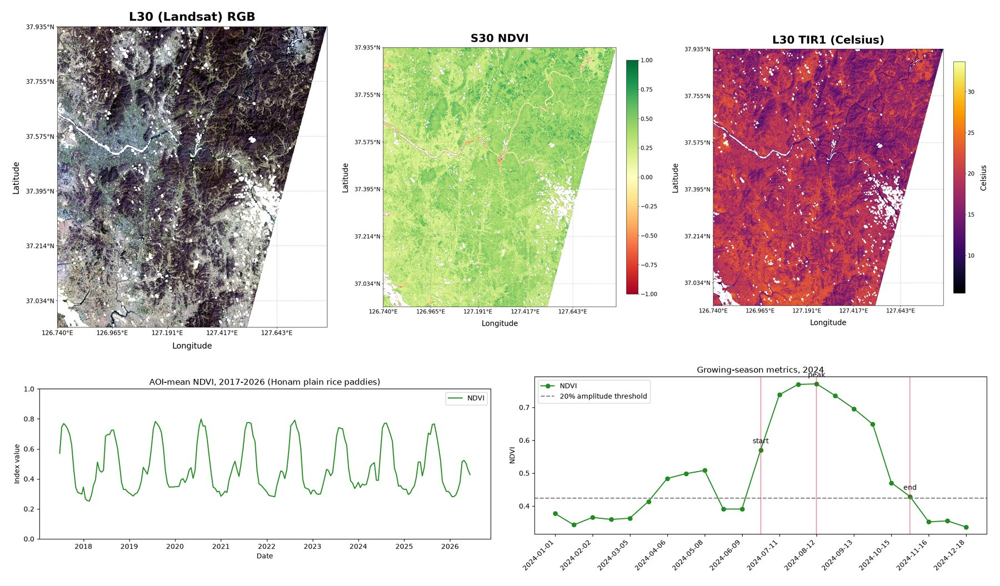

# Remote Sensing Toolkit

[](LICENSE)
[](https://www.python.org/)
[](https://rasterio.readthedocs.io/)
[](tutorials/)

Python utilities for preprocessing and analyzing satellite and geospatial data. The repository has raster and vector GIS helpers, a band reader and plotter for NASA Harmonized Landsat Sentinel-2 (HLS) products, a reader for MODIS MOD13Q1/MYD13Q1 vegetation index time series, and tools for in-situ water quality observation points. Two tutorial notebooks show how the modules take raw downloads to analysis-ready data.



<sub>Figures from the [tutorials](tutorials/): HLS L30/S30 over tile T52SCG (top) and MODIS MOD13Q1 NDVI over the Honam plain (bottom).</sub>

## Contents

| Module | What it does |
|:--|:--|
| [`GIS/raster.py`](GIS/raster.py) | GeoTIFF reading, validity checks, reprojection and plotting |
| [`GIS/vector.py`](GIS/vector.py) | Shapefile reading, CRS checks, reprojection and plotting |
| [`GIS/coordinate.py`](GIS/coordinate.py) | Conversion between DMS and decimal degrees |
| [`HLS.py`](HLS.py) | HLS L30/S30 band reader, RGB and index plotting, MNDWI, Fmask cloud and water decoding |
| [`MODIS.py`](MODIS.py) | MOD13Q1/MYD13Q1 NDVI and EVI reader, Pixel Reliability masking, map and time series plots |
| [`water_quality/obs.py`](water_quality/obs.py) | Observation points to GeoDataFrame, raster sampling around points, Folium maps |
| [`tutorials/`](tutorials/) | Worked preprocessing notebooks for HLS and MODIS |

## Installation

GDAL, `rasterio` and `cartopy` are compiled geospatial libraries, so conda (conda-forge channel) is the most reliable way to install them.

```bash
git clone https://github.com/SeongjunLee4473/remote-sensing-toolkit.git
cd remote-sensing-toolkit

conda create -n remote-sensing python=3.12
conda activate remote-sensing
conda install -c conda-forge rasterio gdal cartopy pyproj geopandas folium tqdm numpy pandas matplotlib xarray netcdf4
```

If GDAL is already installed on your system, `pip install -r requirements.txt` also works.

The modules are not packaged for `pip`. Run your scripts from the repository root, or add the root to `sys.path`.

## Usage

### Raster and vector data

```python
from GIS import raster, vector, coordinate

data, transform, crs = raster.read("path/to/raster.tif")
raster.plot(data, transform=transform, cmap="viridis")

gdf = vector.read("path/to/vector.shp")
vector.plot(gdf)

dd = coordinate.dms_to_dd("37° 43' 55.0\"")
```

### HLS L30/S30

`HLS.BandReader` reads mosaicked bands named `B02_merged_<date>.tif`, `Fmask_merged_<date>.tif` and so on. For raw per-granule files, see the loader in the [HLS tutorial](tutorials/hls_l30_s30/).

```python
import HLS

reader = HLS.BandReader(folder_path="path/to/hls/scene", product="S30", date="2026001")
plotter = HLS.BandPlotter(reader)
plotter.plot_rgb(title="True color")
plotter.plot_false_color(title="False color (NIR-R-G)")

mndwi, transform = HLS.WaterIndicesCalculator(reader).calculate_mndwi()
plotter.plot_index(mndwi, transform, threshold=0.1, title="MNDWI")

cloud_mask = HLS.is_cloud(reader.qa)   # 1 = cloud, shadow or adjacent, 0 = clear
water_mask = HLS.is_water(reader.qa)   # 1 = water
```

### MODIS vegetation index time series

`MODIS.VITimeSeriesReader` expects one NetCDF file exported from NASA AppEEARS (Area request, geographic projection).

```python
import MODIS

reader = MODIS.VITimeSeriesReader("path/to/MOD13Q1.061_250m_aid0001.nc")
ndvi = reader.ndvi()   # unreliable pixels masked by Pixel Reliability
evi = reader.evi()

bbox = (126.70, 35.65, 127.05, 35.95)   # west, south, east, north (WGS84)
ndvi_mean = reader.roi_mean(ndvi, bbox=bbox)

plotter = MODIS.VIPlotter(reader)
plotter.plot_timeseries(ndvi_mean, label="NDVI")
plotter.plot_map(ndvi.isel(time=0).values, title="NDVI")
```

### Water quality observation points

```python
from water_quality import obs

gdf = obs.points_to_gdf("path/to/obs_points.csv")
samples = obs.extract_pixels_near_points(gdf, raster_data, transform, radius_deg=0.001)
m = obs.plot_points("path/to/obs_points.csv", "3008B40")
```

## Tutorials

| Notebook | Topic | Data |
|:--|:--|:--|
| [HLS L30 vs S30](tutorials/hls_l30_s30/) | Valid-pixel ROI intersection, RGB composites, cross-sensor NDVI, L30 thermal and S30 red edge bands | NASA LP DAAC HLS v2.0 |
| [MODIS NDVI/EVI time series](tutorials/modis_vi_timeseries/) | Pixel Reliability masking, NDVI and EVI seasonal curves, start, peak and end of season | NASA LP DAAC MOD13Q1.061 via AppEEARS |

Raw satellite data is not included. Each tutorial README explains where to download it and where to put it.

## License

Released under the [MIT License](LICENSE).

## Contact

Seongjun Lee ([@SeongjunLee4473](https://github.com/SeongjunLee4473))
